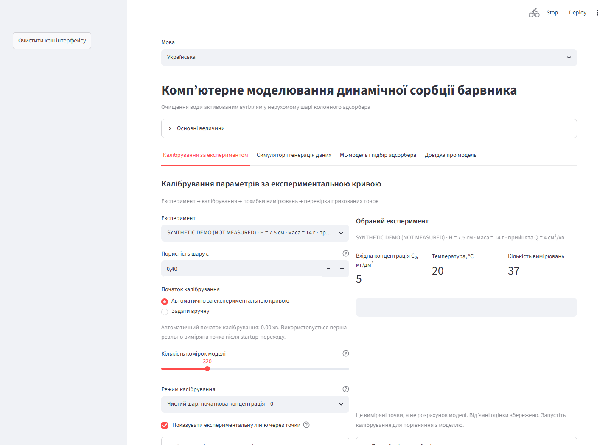
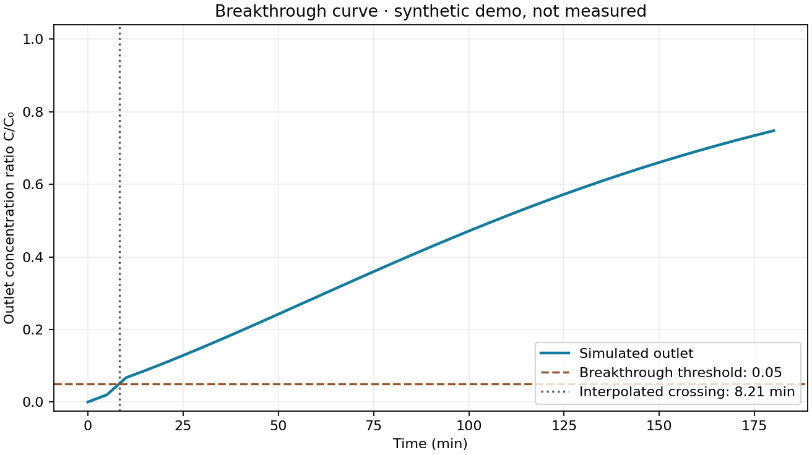

# Adsorption Breakthrough Simulator

A Python and Streamlit research application for simulating the removal of methylene blue from water in a fixed bed of granular activated carbon. It connects a mechanistic column model, experimental-curve calibration, and machine-learning surrogates used for scenario screening.

## Preview

The screenshot and the example curve below use the synthetic demo fixture, not laboratory measurements.





## Streamlit Community Cloud

Deploy `main` with `cloud_app.py` as the entry point and Python 3.12. The public demo opens on a synthetic scenario with a working breakthrough curve, editable column inputs, mass-balance diagnostics and CSV export. It needs no data preparation or secrets.

The demo runs the same mechanistic solver on a fixed-size grid and a bounded input range. There are no input uploads, package installation, local research data or live ML training in the public demo. Do not deploy the full local `app.py` as a public service.

## Run locally

Use Python 3.12 and run the commands from the project root. On Windows (PowerShell):

```powershell
py -3.12 -m venv .venv
.\.venv\Scripts\python.exe -m pip install -r requirements.txt
.\.venv\Scripts\python.exe demo_data.py
.\.venv\Scripts\python.exe -m streamlit run app.py
```

On Linux or macOS:

```bash
python3.12 -m venv .venv
.venv/bin/python -m pip install -r requirements.txt
.venv/bin/python demo_data.py
.venv/bin/python -m streamlit run app.py
```

Open the local URL printed by Streamlit (usually `http://localhost:8501`). The interface opens in Ukrainian; English and Russian are also available. On Windows, the [double-click launcher](Запустить_симулятор.bat) can be used after setup. Stop the server with Ctrl+C in the terminal that started it.

Run `demo_data.py` **only in a fresh checkout**. It generates a clearly labeled synthetic curve and its summary under the filenames expected by the application. It does not read primary measurements or overwrite existing files. Skip this step if you already have the input files, including in the original research workspace.

## What it does

| Workflow | Description |
| --- | --- |
| Simulate | Plot outlet concentration and the normalized breakthrough curve, calculate a threshold crossing, and inspect mass-balance and operating diagnostics. |
| Calibrate | Fit effective sorption and transport parameters to an input curve. The public demo belongs here only as an illustration, not as an experiment. |
| Check hidden points | Refit without manually selected points and compare predictions with those held-out values. This is not validation on an independent experiment. |
| Generate and train | Simulate synthetic scenarios; train a curve surrogate for outlet concentration or a separate model for breakthrough time. Split complete simulation groups by `case_id`. |
| Screen candidates | Use a compatible breakthrough model to screen in-domain column candidates, then verify selected candidates using the mechanistic solver. A curve model does not qualify for direct selection. |

## Mechanistic model

- A one-dimensional, conservative finite-volume model accounts for advection and axial dispersion in the liquid phase. The inlet specifies the total solute flux and the outlet has no dispersive gradient.
- Solid-phase uptake follows linear driving force kinetics: `dq/dt = k_LDF (q* - q)`. The core implements the linear Henry relation `q* = KH C` and a Langmuir branch `q* = KH C / (1 + b C)`. The calibration interface includes a separate Henry–Langmuir comparison; the existing adsorption screening workflow uses Henry.
- SciPy integrates the spatially discretized system with BDF. By default, breakthrough is evaluated at the upward crossing of `C_out/C0 = 0.05`, interpolated between observations. A curve that does not reach the threshold supplies a time bound, not an exact breakthrough time.
- Engineering diagnostics include empty bed contact time (EBCT) and Ergun pressure-drop estimates. These do not establish the validity of a scale-up.

## Inputs and reproducibility

The application reads `cleaned_dynamic_sorption_data.csv` and uses `dynamic_sorption_experiment_summary.csv` for its experiment summary. For authorized research work, [import_experimental_excel.py](import_experimental_excel.py) supports the project's workbook format and recomputes concentrations from the analytical calibration. The public checkout excludes the laboratory workbook, observations, fitted artifacts, the historical synthetic dataset, and saved model bundles. Do not submit those files in issues or commits without permission.

The local demo fixture is enough to explore simulation and calibration. The local ML tab can generate new synthetic cases and train models or accept a compatible dataset. The bundled research result is **not** reproduced by the demo fixture. Model-based screening requires a model that passes the app's existing quality and provenance checks; its manifest and supporting files must match. Load `joblib` files only from trusted sources. For anonymous hosting use `cloud_app.py`, not the local application.

## Code and tools

- `app.py`, `ui_*.py`, `translations.py`: Streamlit interface, visualizations and localization.
- `model.py`, `mass_balance.py`, `industrial_model.py`: numerical model and diagnostics.
- `ml_adsorber.py`, `ml_validation.py`, `selection_verification.py`: ML training, grouped splits and source-aligned mechanistic verification.
- `scientific_provenance.py`, `parameter_provenance.py`: input and parameter provenance checks.

The project uses NumPy, SciPy and pandas for calculations and tables; Matplotlib and Plotly for plots; scikit-learn, joblib and Optuna for ML and model artifacts. Dependencies and their versions are listed in [requirements.txt](requirements.txt).

Run the public smoke tests with `python -m unittest discover -s tests -p test_public_demo.py` in the same virtual environment. See the [Git workflow guide (Ukrainian)](GITHUB_WORKFLOW_UA.md) for maintenance and the conditions for a future hosted demo.

## Scope and limitations

This is a thesis research tool, not a certified design or safety calculator. Fitted parameters are effective coefficients for a specific model and range. Synthetic evaluation tests how closely a surrogate reproduces the simulator, not whether a real adsorber will meet a treatment requirement. Extrapolation, scale-up and competing solutes need separate evidence.

## AI-Assisted Development

ChatGPT and OpenAI Codex assisted with programming, debugging, refactoring and testing. The author defined the research question and physicochemical assumptions and checked the results.
